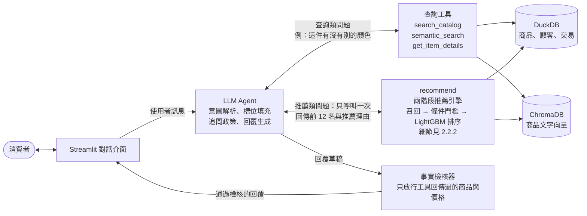
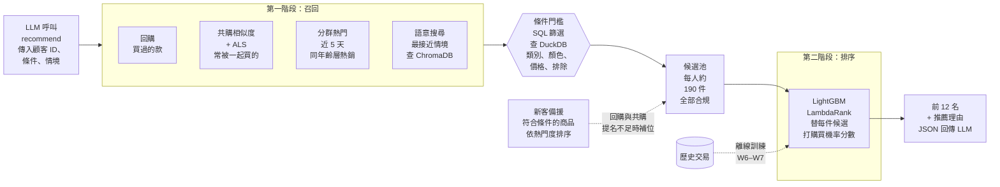

# H&M 對話式時尚推薦系統執行提案

> [!abstract] 摘要（Executive Summary）
> H&M Group 是全球規模最大的快時尚集團之一，2025 財年淨銷售額 SEK 2,283 億，線上通路占比略高於三成。它的核心經營特徵是「品項極多、汰換極快、單價偏低」：本專案使用的公開資料集內有 105,542 個商品品項，但最近四週仍有成交的只占 26.8%，而最熱門的 10% 品項就貢獻了 60.7% 的交易。這代表消費者在 hm.com 上面對的是一座不斷變動的巨大目錄，而現有的「關鍵字搜尋 + 篩選器」只能服務目標明確的需求，模糊需求（「我要一件秋天婚禮穿、不要太正式、價格中等的洋裝」）會直接流失。
>
> 本提案要建立一個**對話式推薦系統（Conversational Recommender System, CRS）**：以大型語言模型（LLM）作為面向消費者的對話大腦，負責意圖解析、主動追問與回覆生成；背後以 Python 與 DuckDB 建構「候選召回 + LightGBM 排序」的兩階段推薦引擎，並以 Function Calling 由 LLM 呼叫。整套系統以 H&M 的 3,179 萬筆真實交易為基礎，因此每一個推薦都有資料佐證，而不是 LLM 的泛泛之談。
>
> 成功與否以兩層指標衡量：離線推薦品質（保留週 MAP@12，目標 ≥ 0.025，約為熱門商品基準線的三倍以上）與對話品質（條件滿足率 ≥ 95%、模擬使用者命中率相對非對話基準提升 ≥ 20%）。專案依課程規劃分三個階段共 16 週（2026-08-25 至 2026-12-11）執行，目前處於 Phase I 尾聲；提案附有三層樞軸方案與可重現的參考研究，確保無論如何都能交付有價值的成果。

---

## 0. 一頁總覽

| 項目       | 內容                                                                                                                      |
| -------- | ----------------------------------------------------------------------------------------------------------------------- |
| 目標公司     | H&M Group（Hennes & Mauritz AB），線上通路 hm.com / App                                                                        |
| 決策者      | H&M 數位產品負責人（Head of Digital Product），實際使用者為 Search & Discovery 產品經理與 Personalization 資料科學團隊                             |
| 要改善的流程   | 消費者在線上「搜尋 → 篩選 → 瀏覽 → 加入購物車」的商品探索流程，特別是模糊需求的承接                                                                          |
| 精確問題     | 給定顧客、多輪對話中表達的需求與限制，以及 10.5 萬件商品目錄，輸出 12 件商品的排序清單，最大化 7 天內購買機率，同時滿足硬性條件並最少化追問次數                                          |
| 方法       | 描述性分析（EDA）→ 預測性（兩階段推薦：召回 + Learning-to-Rank）→ AI（LLM Agent + Function Calling + 向量檢索）→ 處方性（追問 vs. 直接推薦的決策政策）→ 實驗設計（A/B） |
| 核心 KPI   | 搜尋到購買轉換率、搜尋放棄率、客單價、長尾商品曝光占比                                                                                             |
| 專案內可驗證指標 | MAP@12、Recall@12、條件滿足率、槽位抽取 F1、首次推薦所需輪數、p95 延遲、人工評估偏好率                                                                  |
| 交付物      | 可執行的 Streamlit 對話 demo、推薦引擎 Python 套件、評估報告、A/B 實驗設計書、最終簡報                                                               |
| 時程       | 16 週三階段：Phase I 規劃（W1–W3）、Phase II 建置與驗證（W4–W14）、Phase III 成果與繳交（W15–W16）；7 個里程碑（詳見第 4 節）                               |

---

## 1. 商業情境與明確問題（Business Context & Precise Problem）

### 1.1 目標商業領域與公司（Business Domain / Target Company）

**H&M Group** 總部位於瑞典斯德哥爾摩，旗下有 H&M、COS、Weekday、Monki、& Other Stories、ARKET 等品牌，採「設計 → 大量生產 → 快速上架 → 快速汰換」的快時尚模式，在全球以實體店與自營電商（hm.com、App）雙通路銷售。2025 財年（2024-12 至 2025-11）關鍵數字：

| 指標 | 數值 | 來源 |
|---|---|---|
| 淨銷售額 | SEK 228,285 百萬 | H&M Full-year report 2025 |
| 營業利益 / 營業利益率 | SEK 18,395 百萬 / 8.1% | 同上 |
| 線上占比 | 略高於 30% | H&M Nine-month report 2025 |
| 實體店趨勢 | Q4 店數較去年少 4%，持續向線上與旗艦店集中 | H&M Full-year report 2025 |
| 管理層對 AI 的態度 | CEO 明確表示「更多資料驅動決策與 AI 的使用正在提升準確度並強化顧客體驗」 | 同上 |

從本專案使用的公開資料集（Kaggle「H&M Personalized Fashion Recommendations」，涵蓋 2018-09-20 至 2020-09-22 共 104 週）可以直接看出這個商業模式的三個結構性特徵，也是本方案的立足點：

1. **目錄巨大且高速汰換（Discovery 問題）**：105,542 個品項（47,224 個產品款式、131 種商品類型、50 個色系、250 個部門），但最近四週有成交的品項只有 28,297 個（26.8%）。消費者能看到的永遠只是目錄的一小角。
2. **銷售高度集中（長尾曝光問題）**：最熱門 1% 的品項貢獻 18.6% 交易、前 10% 貢獻 60.7%。熱門商品被反覆推薦，新品與長尾商品缺乏曝光機會，這是採購與商品部門的痛點。
3. **高頻、低價、回購明顯（個人化的基礎）**：每位顧客兩年內中位數 9 筆交易（平均 23.3 筆、前 10% 超過 60 筆），14.1% 的交易是同一顧客回購同一品項。這意味著「顧客歷史」是極強的推薦訊號，也是通用聊天機器人不可能擁有的資產。

此外，資料集中 70.4% 的交易來自通路 2。官方資料說明未定義通路代碼，但 2020 年 3 月 23 日至 4 月底的 COVID 封城期間（H&M 當時關閉多達八成門市）通路 1 的交易降為零、通路 2 占 100%，且通路 2 的單日購物籃平均 4.1 件、通路 1 為 2.6 件，可確認通路 2 為線上、通路 1 為實體店。這個線上占比高於集團整體約 30%，顯示這份資料偏向數位活躍客群，恰好是本方案要服務的對象；女裝（Ladieswear 64.2%）與年輕女性品牌 Divided（22.5%）合計近九成，客群輪廓清晰。

### 1.2 決策對象與工作流程（Decision Owner & Workflow）

**主要決策者**：H&M Group 數位產品負責人（Head of Digital Product / Online Customer Experience）。他負責 hm.com 與 App 上「搜尋、瀏覽、推薦」介面的產品決策與資源分配，直接對線上轉換率與線上營收負責。在他之下實際評估、導入與維運本方案的是：

- **Search & Discovery 產品經理**：決定搜尋與推薦介面要顯示什麼、是否上線新的互動入口。
- **Personalization 資料科學團隊**：決定推薦模型的架構、訓練與上線標準。

**次要利害關係人**：

| 角色 | 關心的事 | 本方案提供什麼 |
|---|---|---|
| 商品採購與企劃（Merchandising） | 新品與長尾商品的售罄率、庫存去化 | 可控的長尾曝光比例、以情境而非熱度推薦商品 |
| 客服（Customer Service） | 「我該買哪一件」類型的諮詢量 | 由助理先行承接風格與穿搭諮詢 |
| CRM / 會員經營 | 會員活躍度與回購 | 以會員歷史做個人化，提高會員價值感 |

**要改善的工作流程**：消費者的線上商品探索流程。

| 階段 | 現況（As-is） | 痛點 | 導入後（To-be） |
|---|---|---|---|
| 表達需求 | 輸入關鍵字，手動勾選類別、顏色、尺寸、價格 | 模糊需求無法轉成關鍵字；篩選器維度固定、彼此獨立 | 以自然語言一句話描述場合、預算、偏好與排除條件 |
| 補足資訊 | 無；系統不會追問 | 使用者不知道還缺什麼，結果太多或太少 | 助理在資訊不足時主動追問一個最關鍵的問題（預算 / 用途 / 偏好） |
| 取得結果 | 依熱門度或上架時間排列的商品牆 | 與個人歷史無關；新品與長尾難被看見 | 12 件商品的個人化排序，附上以真實資料為根據的推薦理由 |
| 修正條件 | 回到篩選器重新設定 | 每次修正都是重新開始 | 「便宜一點」「不要黑色」「類似第二件」直接在對話中收斂 |
| 決策品質的回饋 | 產品團隊只能看整體轉換率 | 不知道哪些需求沒被滿足 | 對話紀錄本身就是「未被滿足的需求」的結構化資料 |

### 1.3 精確的問題陳述（Precise Problem Statement）

高階商業目標「提高線上商品探索的轉換率並改善長尾曝光」轉化為以下資料導向問題：

> [!important] 問題定義
> 給定顧客 $c$（可能是新客）、一段多輪對話 $D = (u_1, \dots, u_t)$ 所表達的需求與限制、以及商品目錄 $A$（約 10.5 萬個品項，含結構化屬性與文字描述），輸出一個長度 $K = 12$ 的商品排序清單 $R$，使得
>
> 1. **相關性**：顧客在接下來 7 天內購買 $R$ 中商品的期望機率最大化（離線以 MAP@12 衡量）；
> 2. **合規性**：$R$ 中每一件商品都滿足對話中抽取出的硬性條件（價格帶、類別、顏色、排除清單）；
> 3. **效率性**：達成推薦所需的追問輪數最少；
> 4. **可解釋性**：每一件推薦都能附上可回溯至資料的理由（例如「與你上月購買的品項常被一起購買」、「本週同年齡層女裝熱銷第 3 名」）。

**範圍界定**：

| 納入範圍 | 排除範圍（本期不做，列為未來擴充） |
|---|---|
| 以文字為主的對話、需求抽取與多輪修正 | 圖片輸入與以圖搜圖（資料集另有 30 GB 圖片，列為選配） |
| 老客（有歷史）與新客（冷啟動）兩條推薦路徑 | 即時庫存、尺寸可得性（資料集無此欄位） |
| 離線評估 + 模擬使用者評估 + 小規模人工評估 | 正式線上 A/B 測試（僅交付實驗設計書） |
| 推薦理由的生成與事實檢核 | 結帳與交易完成流程 |

### 1.4 為什麼 H&M 要自己做，而不是讓顧客去問 ChatGPT

價值不在「會聊天」，而在對話背後的**專有資料、交易脈絡與推薦引擎**。通用 LLM 能回答「秋天婚禮可以穿什麼風格」，但只有 H&M 的系統能回答「在 H&M 現有目錄裡、符合你的價格帶、與你過去偏好一致、而且本週真的有人在買的那 12 件」。

以本資料集能支撐的場景為例，使用者說：

> 「下個月要參加朋友的戶外婚禮，想找一件洋裝，不要太正式，也不要黑色，價格中等就好。」

通用 LLM 只能給風格建議；本系統則會：

1. 抽取條件：`product_group = Garment Full body`、`product_type ∈ {Dress}`、`colour ≠ Black`、`price_band = 中價`、情境關鍵字「戶外、婚禮、不正式」。
2. 查詢該顧客歷史：偏好 Divided 品牌線、常買價格帶落在中價偏低、最近三個月買過兩件連身裙。
3. 呼叫推薦引擎：從符合條件的候選中，依個人化排序模型選出 12 件。
4. 生成回覆：「根據你之前在 Divided 買過的兩件連身裙風格，我挑了這三件碎花中長洋裝。第一件是本週同年齡層女裝熱銷前十名，第二件常和你上次買的涼鞋被一起購買……如果想再便宜一點或換成長袖，告訴我就好。」

這就是業界所稱的 **Agentic RAG**：檢索的對象不是文件段落，而是結構化的商品與交易資料；檢索的方式不是語意相似度，而是 LLM 主動呼叫 SQL 查詢與推薦函式。Amazon 的購物助理 Rufus 已證明這條路的商業價值：Amazon 在 2025 年第三季財報中表示 Rufus 有望帶來每年 100 億美元的額外銷售，並稱使用 Rufus 的顧客購買機率高出 60%（此為 Amazon 自行揭露、存在自我選擇偏誤的數字，本提案在估值時採用更保守的假設）。

---

## 2. 數據與分析方法規劃（Data & Analytics Formulation）

### 2.1 相關數據需求（Relevant Data Needed）

#### 2.1.1 已取得的資料（存放於 `data/`）

| 檔案                       | 規模                        | 主要欄位                                                        | 用途                  |
| ------------------------ | ------------------------- | ----------------------------------------------------------- | ------------------- |
| `articles.csv`           | 105,542 列 × 25 欄，34 MB    | 品項 ID、產品款式碼、名稱、商品類型、商品群組、外觀圖樣、色系、部門、品牌線（index）、分區、服裝群組、文字描述 | 商品屬性、SQL 條件篩選、文字向量化 |
| `customers.csv`          | 1,371,980 列 × 7 欄，198 MB  | 顧客 ID、FN、Active、會員狀態、時尚電子報頻率、年齡、郵遞區號（雜湊）                    | 顧客分群、冷啟動特徵          |
| `transactions_train.csv` | 31,788,324 列 × 5 欄，3.2 GB | 日期、顧客 ID、品項 ID、價格（已正規化，×590 可還原近似價）、銷售通路（1 = 實體店、2 = 線上）    | 協同過濾、排序模型標籤、熱門度、回購  |

三張表以 `customer_id` 與 `article_id` 關聯，構成典型的「顧客 – 交易 – 商品」星狀結構，適合以 DuckDB 直接對 CSV / Parquet 做 SQL JOIN。

#### 2.1.2 資料品質與限制（探索性分析結果）

| 項目             | 觀察                                                                                                                                       | 處理方式                                                                      |
| -------------- | ---------------------------------------------------------------------------------------------------------------------------------------- | ------------------------------------------------------------------------- |
| 顧客年齡缺失         | 15,861 筆（1.2%）                                                                                                                           | 保留為「未填」自成一類，不補值也不刪顧客。補中位數（32）會把這 15,861 人併進 30-39 層，B1 的「未填」分群會消失；刪除則少掉 292 位保留週買家，評估母體不再是 68,984                                                              |
| FN / Active 缺失 | 895,050 筆（65.2%）                                                                                                                         | 缺失即視為 0（未訂閱 / 未啟用）                                                        |
| 商品文字描述缺失       | 416 筆（0.4%）                                                                                                                              | 以名稱 + 類型 + 色系組成替代文字                                                       |
| 價格已正規化         | 官方未說明；中位數 0.0254、P10 0.0101、P90 0.0508。Kaggle 討論串 310496 發現原價被除以 590，乘回後最常見價格為 9.99、19.99、14.99，與 H&M 官網定價一致（本專案資料重算結果相同）；幣別推測為歐元，未獲官方證實 | 介面顯示以 ×590 還原的近似價格並標示「約」；篩選以品牌線內百分位切成「平價 / 中價 / 高價」三個價格帶；使用者說出金額時換算為 ×590 價位上限直接篩選，說「平價 / 中價」時對應價格帶 |
| 無圖片            | 圖片為另一個 30 GB 壓縮檔，尚未下載                                                                                                                    | 第一期純文字；若時程允許於 W12 以 CLIP 向量作為選配                                           |
| 無庫存、退貨、尺寸、瀏覽點擊 | 資料集僅有成交紀錄                                                                                                                                | 退貨率與庫存相關 KPI 列為「上線後才可衡量」，提案中明確標示                                          |
| 季節性明顯          | 2020 年 6 月 176 萬筆為高峰，1–3 月約 100 萬筆                                                                                                       | 訓練視窗採「保留週之前 4–8 週」並以時間切分，避免季節錯配與資料洩漏                                      |
| 冷啟動比例          | 保留週（2020-09-16 至 09-22）的 68,984 位購買者中 8.1% 沒有任何歷史交易                                                                                      | 為新客設計「分群熱門 + 對話條件」的獨立路徑                                                   |
| 授權             | Kaggle 競賽資料僅供學術與競賽用途                                                                                                                     | 本專案為教學與概念驗證；商業化須改接 H&M 自有資料，架構可直接沿用                                       |

#### 2.1.3 需自行建構的衍生資料

| 衍生表                    | 內容                                                                      | 建置工具                             |
| ---------------------- | ----------------------------------------------------------------------- | -------------------------------- |
| `article_profile`      | 商品屬性 + 近 1 / 4 / 12 週銷量、不重複購買人數、近似價格（×590）、品牌線內價格百分位、購買者年齡分布、通路比例、類別內排名 | DuckDB SQL                       |
| `article_embedding`    | 以「名稱 + 類型 + 色系 + 部門 + 文字描述」組成的文字向量                                      | sentence-transformers → ChromaDB |
| `customer_profile`     | RFM（最近一次、頻率、金額）、偏好品牌線 / 部門 / 色系分布、慣用價格帶、年齡層                             | DuckDB SQL                       |
| `item_item_similarity` | 共同購買相似度與 implicit ALS 隱因子相似度；ALS 同時保留顧客隱因子向量，供 W5 比較兩種召回用法                                            | Python `implicit`                |
| `synthetic_dialogues`  | 300 組由真實購買紀錄反推的模擬對話（見 2.2.4）                                            | LLM 使用者模擬器                       |

#### 2.1.4 資料來源探索與擴充規劃

- **短期（本專案內）**：Kaggle 圖片檔（選配）、公開的時尚屬性詞庫（用於情境關鍵字 → 屬性的對應，例如「婚禮」→ 洋裝 / 正式）。
- **中期（若與 H&M 合作）**：站內搜尋紀錄與零結果查詢、瀏覽與加購事件、庫存與尺寸、退貨原因。這四項會讓「主動追問」與「退貨率」KPI 成為可能。
- **備援研究資料**：Fashion IQ（77,684 張 Amazon 時尚圖片與相對描述）、Microsoft RecAI 的 InteRecAgent 公開資料（遊戲 / 電影 / 美妝三個領域），詳見第 5.3 節。

### 2.2 分析方法論（Analytics Approach / Formulation）

#### 2.2.1 系統架構

分層原則：**LLM 只做語言的事，數字的事交給引擎**。LLM 負責理解需求、決定要不要追問、把結果講成人話；商品能不能推薦、排第幾名，由 SQL 與排序模型決定。LLM 的輸出必須通過事實檢核器，只有工具回傳過的 `article_id` 與價格才能出現在回覆中，杜絕幻覺。

LLM 依問題類型走兩條呼叫路徑：

- **查詢路徑**：「這件有沒有別的顏色」「有沒有紅色針織衫」這類只需要查資料的問題，LLM 直接呼叫查詢工具，結果原樣回傳，不經過排序。
- **推薦路徑**：「幫我挑幾件」這類需要個人化的問題，LLM 只呼叫一次 `recommend`，把顧客 ID、硬性條件與情境關鍵字一起傳入。候選召回、條件篩選與排序全部在引擎內完成，細節見 2.2.2。

**為什麼推薦路徑只呼叫一次**：另一種做法是讓 LLM 自行規劃，依序呼叫檢索與排序工具，並在工具之間傳遞候選商品，5.3 節的 InteRecAgent 即採此設計。本專案選擇把流程固定在引擎內，理由有三：

1. 離線評估需要對保留週的所有顧客批次產生推薦並計算 MAP@12，流程必須是不依賴 LLM 的固定程式。
2. LLM 只來回一次，延遲與 API 成本較低，有助於達成 p95 ≤ 5 秒的目標。
3. 步驟寫死在程式中，不會因 LLM 漏呼叫某個步驟而產生不合規的推薦。

若進入樞軸 C 重現 InteRecAgent，可直接比較兩種設計在命中率、延遲與成本上的差異。

#### 2.2.2 推薦引擎：兩階段架構（召回 + 排序）

這是 Kaggle H&M 競賽獲獎方案的共同配方，也是業界主流做法。下圖為 `recommend` 內部的完整流程：

**第一階段：候選召回（每位顧客約 190 個候選）**

> 原訂每人 50–100 件。驗證週的掃描顯示加到 190 件仍在換到撈中率，而 2.2.4 節本來
> 就把「每人候選數上限」列為要在驗證週上選的參數，因此採 190。代價落在 W6：候選
> 越多，排序模型的訓練資料越大（目前共 1,391 萬組）。逐項依據見實作紀錄
> 《候選池施工紀錄》。

| 召回來源   | 依據的資料事實             | 實作                            |
| ------ | ------------------- | ----------------------------- |
| 回購候選   | 14.1% 的交易是同品項回購（此數字含同一籃買多件；排除後為 4.4%） | 顧客近 12 週買過的品項。**同款其他顏色原訂納入，W5 實測划不來已關閉**：它每個候選只換到 0.024% 撈中率，是所有設計裡最差的一項（程式裡保留開關 `EXPAND_COLOURS`，候選預算放寬後可重評） |
| 商品協同過濾 | 顧客共購行為 | 共購相似度 + `implicit` ALS 隱因子。ALS 有兩種用法：一是以商品隱因子算商品相似度，二是以顧客隱因子直接對全商品打分取前 N 名，後者對老客通常更準。W5 實作了第二種（每人取前 25 名，含 BM25 加權與 factors 維度的消融）；**第一種尚未實作，兩種用法的比較仍待補**，因此 W5 的這條驗收標準未達成 |
| 分群熱門   | 前 10% 品項貢獻 60.7% 交易 | **近 5 天 × 年齡層**的熱銷榜，每群取前 170 名。原訂「近 14 天 × 年齡層 × 品牌線」，W5 兩折實測發現品牌線那一維在扣分（撈中率 18.11% → 19.24%），且移除後純新客也拿得到候選（原本 7.5% 的買家四源全空）。B0 / B1 基準線仍用原定義，刻意不跟著改 |
| 語意檢索   | 對話中的情境詞（「婚禮」「露營」）   | 商品文字向量的近鄰搜尋                   |
| 條件門檻與新客備援 | 對話中的硬性條件；保留週 8.1% 購買者沒有歷史紀錄 | DuckDB SQL（價格帶或價位上限、類別、顏色、排除）。對所有來源的候選一律套用；新客的回購與共購提名不足時，直接以篩選結果依熱門度補位 |

條件門檻對所有來源一律套用，因此進入排序的每一個候選都合規。門檻與語意檢索和 LLM 可直接呼叫的 `search_catalog`、`semantic_search` 共用同一套程式，差別只在查詢路徑直接回傳結果，推薦路徑則把結果當作候選，再交給排序模型。

**第二階段：排序（Learning-to-Rank）**

- 模型：LightGBM LambdaRank（備選：二元分類 LightGBM）。
- 訓練資料：以週為單位建立多個 fold，每個 fold 的候選來自上述召回，標籤為「該顧客在該週是否購買此品項」。
- 特徵（三類）：顧客特徵（RFM、偏好分布、年齡）、商品特徵（近期銷量、價格百分位、上架時間、類別）、顧客 × 商品交互特徵（是否買過同款、與歷史購買的相似度、候選來源、價格帶差距、與查詢文字的向量相似度）。
- 輸出：封裝為 `recommend(customer_id, constraints, k)` 的 Python 函式與 FastAPI 端點，供 LLM 呼叫。

#### 2.2.3 對話層：LLM Agent 與工具

- **LLM 選擇**：任何支援 Function Calling 的模型皆可（Claude、OpenAI、Gemini）。開發階段以成本較低的中小型模型進行，最終 demo 視預算決定；架構與提示詞設計保持供應商中立。
- **槽位（slot）結構**：`index_group`、`product_group / product_type`、`colour`、`price_band` / `price_max`（使用者說的金額換算為 ×590 價位上限）、`occasion_keywords`、`exclusions`、`reference_article`（「類似第二件」）。
- **追問政策（處方性決策）**：若使用者為新客且「類別」與「預算」兩者皆未知，追問一個問題（預算可用金額或平價 / 中價 / 高價回答，金額以 ×590 價位換算）；若有歷史則以歷史推估價格帶，僅追問類別。每輪最多追問一次，避免審問感。這個政策可用模擬器調整閾值。
- **修正操作對應**：「便宜一點」→ 價格帶下調一級；「20 歐元以內」→ 設定 `price_max`；「不要 X」→ 加入排除清單；「類似第 N 件」→ 以該品項做相似度召回；「換成長袖」→ 屬性覆寫。
- **回覆生成規則**：每件推薦附一句理由，理由來源必須是工具回傳的欄位（近期銷量排名、共購關係、與歷史的關聯），並以事實檢核器驗證。

> [!example] 對話範例（以資料集可支撐的內容為準）
> **使用者**：我想找件洋裝，下個月參加戶外婚禮穿，不要太正式也不要黑色。
> **助理**：好的，先確認一下預算大概多少？也可以直接說平價、中價或高價。（顧客為新客，預算未知 → 追問一次）
> **使用者**：30 歐元以內。
> **助理**（30 歐元換算為 `price_max`，呼叫 `search_catalog` + `recommend`）：幫你挑了三件 30 歐元以內的非黑色洋裝：
> 1. **碎花 V 領中長洋裝**（Ladieswear / Dress，約 €24.99）— 本週同年齡層女裝熱銷第 4 名，適合戶外場合。
> 2. **棉質襯衫式洋裝**（Divided / Dress，約 €19.99）— 常與涼鞋一起購買，風格輕鬆不正式。
> 3. **無袖印花長洋裝**（Ladieswear / Dress，約 €29.99）— 近四週回購率在洋裝類別中前 10%。
> 想再便宜一點、換成長袖，或看更多類似第 1 件的款式嗎？
> **使用者**：類似第一件但便宜一點。
> **助理**（以第 1 件做相似度召回，價格帶下調一級）：這三件與第 1 件風格接近、價格都在 €15 以下……
> 價格為 ×590 還原的近似值，幣別依 Kaggle 社群推測為歐元，見 2.1.2 節。

#### 2.2.4 評估方法

**（1）離線推薦評估**：資料切成三段。**保留週**（2020-09-16 至 09-22）只在最後評估時跑一次；
**驗證週**（09-09 至 09-15）用來做所有參數選擇（熱銷區間長度、每人候選數上限等）；其餘為**訓練資料**。
選定參數後，最終模型以 09-15 之前的全部資料重新訓練，再於保留週評估一次。

保留週有 68,984 位購買者、240,311 筆交易、17,986 個被購買品項；**評估母體即這 68,984 人**，
正解為每人該週買過的相異品項（全體 213,728 組）。所有模型使用相同的候選集，公平比較：

- B0：全站近 14 天熱銷前 12 名（最低基準）。14 天由驗證週掃描選出，非看保留週分數挑選，推導見 `eda.ipynb` §4.2
- B1：分群熱門（年齡層 × 品牌線）
- B2：兩階段推薦引擎（無對話）
- B3：兩階段推薦引擎 + 對話條件（本方案）

**（2）對話評估（模擬使用者）**：從保留週抽樣 300 組「顧客 – 實際購買品項」，讓 LLM 扮演使用者：只看得到目標品項的屬性（不看 ID），先寫一句模糊需求，再回答助理的追問。衡量目標品項（或同款）是否進入前 12 名、條件滿足率、追問輪數。這是對話式推薦研究的標準做法（見 5.3 節 InteRecAgent 與 CIKM 2023 論文）。

**（3）人工評估**：至少 10 位受試者 × 5 個情境，成對比較「對話助理」與「關鍵字搜尋 + 篩選器」，記錄偏好與 1–5 分的有用度。

#### 2.2.5 技術堆疊

| 分層 | 工具 | 選用理由 |
|---|---|---|
| 資料層 | DuckDB + Parquet | 3.2 GB CSV 載入約數秒，SQL JOIN 直覺，不需架資料庫伺服器 |
| 向量層 | sentence-transformers + ChromaDB | 純 Python、可本機執行、10 萬筆向量足夠輕量 |
| 推薦引擎 | Python：`implicit`、`lightgbm`、`scikit-learn` | Kaggle 驗證過的組合 |
| 對話層 | LLM API（Function Calling）+ 自訂工具層（不強依賴 LangChain） | 工具數量少，直接呼叫 API 比框架更透明、易除錯 |
| 服務層 | FastAPI | 將推薦引擎與工具封裝為 HTTP 端點 |
| 介面 | Streamlit | 純 Python 即可完成類 ChatGPT 的介面 |
| 評估 | 自建評估腳本 + LLM-as-judge | 可重複、可版本控制 |

---

## 3. 量化價值與衡量指標（Value Measurement & Measurable Outcome）

### 3.1 核心 KPI（上線後由決策者追蹤）

| KPI | 定義 | 方向 | 為什麼重要 | 產業參考 |
|---|---|---|---|---|
| 搜尋到購買轉換率（主要） | 有搜尋 / 助理互動的工作階段中完成購買的比例 | ↑ | 直接對應線上營收 | Amazon 稱 Rufus 使用者購買機率高 60%（自報，含選擇偏誤） |
| 搜尋放棄率 | 搜尋後未點擊任何商品即離開的比例 | ↓ | 模糊需求流失的直接量化 | — |
| 客單價（AOV）與每單件數 | 平均每筆訂單金額與件數 | ↑ | 對話中的「搭配」推薦帶動交叉銷售 | — |
| 長尾與新品曝光占比 | 推薦位中非前 10% 熱門品項的比例 | ↑ | 商品部門的售罄率與庫存去化 | 資料集中前 10% 品項占 60.7% 交易 |
| 助理採用率 | 線上工作階段中使用助理的比例 | ↑ | 決定價值規模的乘數 | — |
| 退貨率（未來） | 助理推薦商品的退貨率 | ↓ | 需退貨資料，本期無法衡量 | — |

### 3.2 專案內可驗證的指標與目標值

| 指標 | 衡量方式 | 目標值 | 基準參考 |
|---|---|---|---|
| MAP@12 | 保留週離線評估，母體為 68,984 位買家；AP 分母取 min(正解數, 12) | ≥ 0.025。相對門檻另記「≥ B0 的 3 倍」（B0 單週 0.00710，3 倍為 0.0213），兩者以較嚴的 0.025 為準 | Kaggle 銀牌方案（第 45 / 3,006 名）私榜 0.02996；學術論文的雙塔模型約 0.034 |
| Recall@12 ＝ 命中數 ÷ 正解數（不套 min()） | 同上 | 相對 B0 提升 ≥ 100% | B0 = 0.00710、B1 = 0.00927，W4 已計算 |
| 模擬對話命中率（HitRate@12） | 300 組模擬對話 | 相對 B2（無對話）提升 ≥ 20% | — |
| 條件滿足率 | 推薦品項符合所有硬性條件的比例 | ≥ 95% | — |
| 槽位抽取 F1 | 100 句人工標註語句 | ≥ 0.90 | — |
| 首次推薦所需輪數 | 模擬對話中位數 | ≤ 2 | — |
| 端到端延遲 | p95 | ≤ 5 秒 | — |
| 人工評估 | 10 人 × 5 情境成對比較 | 偏好助理 ≥ 60%；有用度 ≥ 4 / 5 | — |
| 長尾占比（診斷） | 推薦位中非前 10% 熱門品項比例 | 報告實際值，目標 ≥ 25% | — |

### 3.3 價值估算（敏感度分析）

以 H&M 2025 財年淨銷售額 SEK 2,283 億、線上占比約 30% 推算，線上銷售約 SEK 685 億。增量營收以下列簡化公式估算：

$$\Delta \text{Revenue} \approx \text{Online Sales} \times a \times u$$

其中 $a$ 為經由助理互動的線上營收占比（採用率的營收版本），$u$ 為助理工作階段的相對轉換提升。Amazon 自報的 60% 提升含嚴重自我選擇偏誤，本估算保守採 5–20%。

| 採用率 $a$（列）／ 轉換提升 $u$（欄） | 5% | 10% | 20% |
|---|---|---|---|
| **5%** | SEK 1.7 億 | SEK 3.4 億 | SEK 6.9 億 |
| **10%** | SEK 3.4 億 | SEK 6.9 億 | SEK 13.7 億 |
| **20%** | SEK 6.9 億 | SEK 13.7 億 | SEK 27.4 億 |

即使在最保守的格子（5% 採用、5% 提升），增量營收也達 SEK 1.7 億，相較於一個資料科學團隊一年的建置與 LLM 推論成本，投資報酬率明確。此表的用途是讓決策者看到「哪一個乘數最值得投資」：採用率取決於入口設計與行銷，轉換提升取決於推薦品質，兩者本專案都有對應的指標。

### 3.4 驗證方法

**離線驗證協定**：嚴格時間切分。**所有參數選擇一律在驗證週（09-09 至 09-15）上做，保留週（09-16 至 09-22）只在最後跑一次**——
拿保留週的分數挑參數等同於用測試集調參，會系統性高估成績（實例：熱銷區間取 7 天在保留週得 0.00875、為六個候選中最高，
但在驗證週只排第二，該高分有一部分是該週的運氣）。特徵只用評估目標週之前的資料，候選集對所有模型相同。
穩健性另以最近 12 週滾動驗證確認，見《B0 基準線的單週評估風險與滾動驗證》。

**模擬驗證**：300 組模擬對話固定種子、版本控制，每次改動提示詞或模型都重跑，形成回歸測試。

**上線驗證（交付實驗設計書）**：
- 隨機單位：顧客（避免同一人跨組）；處理組看得到助理入口，對照組維持現有搜尋。
- 主要指標：搜尋到購買轉換率；次要：AOV、搜尋放棄率、長尾曝光；護欄：p95 延遲、客服聯繫率、每工作階段 LLM 成本。
- 檢定力：假設基準轉換率 3%、要偵測 5% 的相對提升、$\alpha = 0.05$、檢定力 80%，每組約需 20 萬個工作階段；以 H&M 線上流量約數天可達成，建議跑滿 2 週以涵蓋週間週末差異。
- 分析：依新客 / 老客、品牌線分層報告，避免 Simpson 悖論。

---

## 4. 時程規劃與執行步驟（Granular Timeline & Execution Plan）

> [!note] 時程依據
> 依課程規劃（Slide 9–11），專案共 16 週、分三個階段：Phase I（W1–W3）專案規劃與 Executive Buy-in 簡報；Phase II（W4–W14）資料探索、分析模型建置、AI 輔助實作與驗證；Phase III（W15–W16）量化成果評估、最終簡報與完整報告繳交。以 USC 2026 秋季學期推算，W1 自 2026-08-25（週二）起算，W15 結束於 12-04，W16（12-07 至 12-11）為期末週。本提案撰寫於 W3（09-10），即 Phase I 的交付物。團隊假設 3–4 人。若完整報告的硬性截止日為 12-05，W16 的內容提前併入 W15，於 12-04 一併繳交。

### 4.1 三階段總覽

| 階段                 | 週次      | 日期            | 目標                              | 主要產出                        |
| ------------------ | ------- | ------------- | ------------------------------- | --------------------------- |
| Phase I 規劃與 Buy-in | W1–W3   | 08-25 – 09-11 | 定義商業問題、選定資料、取得 Executive Buy-in | 本提案、Buy-in 簡報               |
| Phase II 建置與驗證     | W4–W14  | 09-14 – 11-27 | 推薦引擎 → 對話層 → 整合 → 評估            | 推薦引擎、對話 demo、評估報告、A/B 實驗設計書 |
| Phase III 成果與繳交    | W15–W16 | 11-30 – 12-11 | 量化成果、最終簡報、完整報告                  | 最終簡報、完整報告、程式碼與 demo 影片      |

### 4.2 逐週交付表

| 週次  | 日期            | 階段  | 交付成果                                                                  | 學習與應用方法                                   | 驗收標準                               |
| --- | ------------- | --- | --------------------------------------------------------------------- | ----------------------------------------- | ---------------------------------- |
| W1  | 08-25 – 08-28 | I   | 題目方向確立：對話式推薦系統（CRS）與 Agentic RAG 架構草稿、User Story 與 Business Value 初稿  | 問題框架、使用者故事撰寫                              | 已完成                                |
| W2  | 08-31 – 09-04 | I   | 資料集評估與選定： Kaggle H&M；下載 articles、customers、transactions 三份檔案          | 資料來源評估、授權確認                               | 已完成                                |
| W3  | 09-07 – 09-11 | I   | 執行提案（本文件）、DuckDB 初步統計、Executive Buy-in 簡報                             | SQL（DuckDB）、商業案例撰寫                        | **M0：提案與 Buy-in 簡報交付（09-11）**      |
| W4  | 09-14 – 09-18 | II  | 專案倉庫、DuckDB / Parquet 資料管線、EDA 筆記本、評估框架（時間切分 + MAP@12 程式）、B0 / B1 基準線 | 探索性資料分析、推薦評估指標                            | **M1：任何人 10 分鐘內可重跑 EDA 與基準線**      |
| W5  | 09-21 – 09-25 | II  | 召回模組 v1：回購、共購相似度、implicit ALS、分群熱門；召回覆蓋率報告，內含 ALS 兩種用法的比較與採用決定        | 協同過濾、隱因子模型、召回覆蓋率分析                        | 保留週實際購買品項被召回的比例 ≥ 30%；ALS 兩種用法完成比較 |
| W6  | 09-28 – 10-02 | II  | 特徵工程表（顧客 / 商品 / 交互）、LightGBM 排序模型 v1、與基準線比較                           | Learning-to-Rank（LambdaRank）、時間感知驗證、特徵重要度 | MAP@12 > B1                        |
| W7  | 10-05 – 10-09 | II  | 排序模型調參與消融、`recommend()` API + FastAPI 端點、滾動週次穩定性檢查                   | 超參數搜尋、消融實驗、API 設計                         | **M2：推薦引擎 v1，MAP@12 ≥ 0.020**      |
| W8  | 10-12 – 10-16 | II  | 商品文字向量 + ChromaDB、`semantic_search` 與 `search_catalog` 工具、價格帶定義       | 文字嵌入、向量檢索、SQL 工具化                         | 情境詞查詢（婚禮、露營）人工檢視相關率 ≥ 80%          |
| W9  | 10-19 – 10-23 | II  | LLM Agent v1：槽位抽取、追問政策、Function Calling、修正操作、事實檢核器；CLI 版對話            | LLM 工具呼叫、提示詞工程、對話狀態管理                     | 100 句標註語句槽位 F1 ≥ 0.85              |
| W10 | 10-26 – 10-30 | II  | 模擬使用者與 300 組合成對話、對話評估腳本、期中進度報告                                        | 使用者模擬、LLM-as-judge、評估設計                   | **M3：對話系統 v1 + 期中檢查**              |
| W11 | 11-02 – 11-06 | II  | Streamlit 介面、推薦理由生成、新客路徑、延遲最佳化（快取、批次查詢）                               | 前端整合、效能剖析                                 | p95 延遲 ≤ 5 秒                       |
| W12 | 11-09 – 11-13 | II  | 人工評估（10 人 × 5 情境）、問題修正、選配：CLIP 圖片向量                                   | 使用者研究、成對比較設計                              | 偏好率與有用度資料收齊                        |
| W13 | 11-16 – 11-20 | II  | 完整消融（B0–B3）、長尾占比與多樣性分析、A/B 實驗設計書、價值敏感度分析                              | 實驗設計、檢定力計算、商業案例分析                         | **M4：評估報告完成**                      |
| W14 | 11-23 – 11-27 | II  | 緩衝週：滾動週次穩健性確認、程式碼凍結、README、demo 影片（感恩節週，工作量減半）                       | 技術寫作、可重現性                                 | 程式碼凍結，他人可依 README 重跑               |
| W15 | 11-30 – 12-04 | III | 量化成果彙整（各指標對照目標值）、最終簡報製作與排練、現場 demo                                    | 簡報與說故事、成果量化                               | **M5：最終簡報與 demo（12-04）**           |
| W16 | 12-07 – 12-11 | III | 完整報告繳交、依回饋修訂                                                          | 技術寫作                                      | **M6：完整報告繳交（若截止為 12-05 則與 M5 同日）** |

### 4.3 里程碑

| 里程碑 | 日期    | 內容                       | 若未達成的處置              |
| --- | ----- | ------------------------ | -------------------- |
| M0  | 09-11 | 提案 + Executive Buy-in 簡報 | 依回饋修訂提案，最晚 W4 定案     |
| M1  | 09-18 | 資料管線 + 評估框架 + 基準線        | 觸發 5.2 節樞軸 C 的評估     |
| M2  | 10-09 | 推薦引擎 v1（MAP@12 ≥ 0.020）  | 若低於 B1 → 樞軸 A        |
| M3  | 10-30 | 對話系統 v1 + 期中檢查           | 若工具呼叫不穩定 → 樞軸 B      |
| M4  | 11-20 | 評估報告 + A/B 實驗設計書         | 縮減人工評估規模，以 W14 緩衝週補齊 |
| M5  | 12-04 | 最終簡報與 demo               | —                    |
| M6  | 12-11 | 完整報告繳交                   | —                    |

### 4.4 建議分工

| 角色      | 負責                        | 主要週次               |
| ------- | ------------------------- | ------------------ |
| 資料與推薦引擎 | DuckDB 管線、召回、排序模型、API     | W4–W7、W13          |
| 對話與 LLM | 工具設計、Agent、追問政策、事實檢核      | W8–W11             |
| 評估與商業分析 | 評估框架、模擬器、人工評估、A/B 設計、價值估算 | W4、W10、W12–W13、W15 |
| 整合與呈現   | Streamlit、demo、報告與簡報      | W11、W14–W16        |

四項角色在 3 人團隊時由「評估與商業分析」與「整合與呈現」合併。

---

## 5. 應變計畫（Contingency Plan / Pivot Strategy）

### 5.1 潛在瓶頸與緩解措施

| # | 瓶頸 | 發生機率 | 影響 | 緩解措施 |
|---|---|---|---|---|
| 1 | 3,179 萬筆交易在筆電上做特徵工程過慢或記憶體不足 | 高 | 排序模型延誤 | 一律走 DuckDB + Parquet；訓練只用保留週前 4–8 週；顧客抽樣（如 20 萬人）；每人候選上限 50。Kaggle 銀牌方案即在 50 GB 記憶體下以此完成 |
| 2 | LLM API 成本或速率限制 | 中 | 開發與評估受阻 | 開發期用小模型；模擬對話快取；限制每輪工具呼叫次數；本機模型（Ollama）作為開發備援 |
| 3 | 價格已正規化且幣別未經官方證實 | 確定 | 對話體驗 | 以 ×590 還原的近似價格顯示並標示「約」，篩選仍走百分位價格帶；真實部署時直接使用實際價格 |
| 4 | 無圖片，時尚商品的視覺屬性無法表達 | 確定 | 推薦精度上限 | 以文字描述與屬性代替；CLIP 向量列為 W12 選配 |
| 5 | 沒有真實使用者，對話評估難以說服人 | 高 | 說服力 | 模擬使用者 + LLM-as-judge + 10 人人工評估三管齊下，並明確揭露各方法的偏誤 |
| 6 | 排序模型不如分群熱門基準線 | 中 | 核心價值受損 | 候選來源本身已是強基準；退回「召回分數加權融合」仍可支撐對話系統 |
| 7 | LLM 幻覺（捏造商品或價格） | 高 | 信任崩壞 | 事實檢核器強制只輸出工具回傳的 ID 與欄位；回覆模板化；評估中加入「幻覺率」指標 |
| 8 | 團隊成員時間衝突 | 中 | 時程延誤 | 每週固定同步；W14 預留緩衝週；範圍縮減順序事先定義（見 5.2） |

### 5.2 樞軸方案

| 方案 | 觸發條件 | 內容 | 保留的價值 |
|---|---|---|---|
| **A：縮小引擎、保留對話** | M2 時排序模型未超越分群熱門基準 | 放棄 LightGBM 排序，推薦引擎改為「SQL 條件篩選 + 共購相似度 + 分群熱門」的加權融合 | 對話式推薦的完整流程與評估仍成立，Demo 不受影響 |
| **B：保留引擎、簡化對話** | M3 時 Agent 工具呼叫穩定性不足 | 對話層退為單輪：使用者一句話 → 槽位抽取 → 推薦 + 理由生成，不做多輪修正 | 個人化推薦引擎與可解釋性完整交付，可比較 Kaggle 成績 |
| **C：複製並改進公開研究** | M1 前資料管線或環境嚴重受阻 | 以 Microsoft RecAI 的 InteRecAgent 公開程式碼與資料（遊戲 / 電影 / 美妝）重現其對話推薦結果，再把工具層換成 H&M 目錄做遷移實驗 | 仍是同一架構（LLM 大腦 + 推薦工具），且有已發表的基準可對照 |

縮減順序（若時程不足，依序放棄）：CLIP 圖片向量 → 人工評估規模 → 多樣性重排 → 滾動驗證 → 多輪修正（退回方案 B）。

### 5.3 參考文獻與可重現資料（Research Paper & Accessible Data）

| # | 研究 | 來源與資料 | 與本專案的關係 |
|---|---|---|---|
| 1 | Huang, X., Lian, J., Lei, Y., Yao, J., Lian, D., Xie, X. *Recommender AI Agent: Integrating Large Language Models for Interactive Recommendations.* ACM Transactions on Information Systems, 2025（arXiv:2308.16505） | 程式碼與資料：[microsoft/RecAI（InteRecAgent）](https://github.com/microsoft/RecAI/blob/main/InteRecAgent/README.md)；提供遊戲、電影、美妝三個領域可直接執行的資料 | **主要複製對象**。架構與本提案完全一致：LLM 作為大腦，推薦工具分為 query（SQL 查詢）、retrieval（SQL 與相似度）、ranking 三類。樞軸 C 直接重現此研究 |
| 2 | He, Z., Xie, Z., Jha, R., Steck, H., Liang, D., Feng, Y., Majumder, B., Kallus, N., McAuley, J. *Large Language Models as Zero-Shot Conversational Recommenders.* CIKM 2023 | 程式碼與評估資料：[AaronHeee/LLMs-as-Zero-Shot-Conversational-RecSys](https://github.com/AaronHeee/LLMs-as-Zero-Shot-Conversational-RecSys)；Reddit-Movie 資料集於 Hugging Face | 提供對話式推薦的**評估方法論**與 LLM 零樣本基準，是 2.2.4 節模擬評估的依據 |
| 3 | Wu, H., Gao, Y., Guo, X., Al-Halah, Z., Rennie, S., Grauman, K., Feris, R. *Fashion IQ: A New Dataset Towards Retrieving Images by Natural Language Feedback.* CVPR 2021 | 資料與程式碼：[XiaoxiaoGuo/fashion-iq](https://github.com/XiaoxiaoGuo/fashion-iq)；77,684 張 Amazon 時尚圖片（洋裝、襯衫、上衣）附相對描述 | **時尚領域**的多輪修正（「更休閒一點」「袖子短一點」）資料，可用來訓練或評估本專案的修正操作；若加入圖片，為選配模組的基礎 |
| 4 | Kaggle *H&M Personalized Fashion Recommendations*（2022，3,006 隊） | 資料即本專案資料；銀牌方案開源程式碼 [Wp-Zhang/H-M-Fashion-RecSys](https://github.com/Wp-Zhang/H-M-Fashion-RecSys)（第 45 名，私榜 MAP@12 0.02996，2 種召回 × 3 種排序模型）；第 1 名解法討論串 #324070 | 推薦引擎的**可重現基準**與工程做法（50 GB 記憶體、每人 50 候選、4 週訓練資料） |

---

## 附錄 A：資料探索統計（2026-09-10 以 DuckDB 計算）

| 項目                                             | 數值                                                                                              |
| ---------------------------------------------- | ----------------------------------------------------------------------------------------------- |
| 交易期間                                           | 2018-09-20 至 2020-09-22                                                                         |
| 交易筆數                                           | 31,788,324                                                                                      |
| 有交易的顧客數 / 顧客總數                                 | 1,362,281 / 1,371,980                                                                           |
| 有成交的品項數 / 品項總數                                 | 104,547 / 105,542                                                                               |
| 最近四週有成交的品項                                     | 28,297（26.8%）                                                                                   |
| 通路 1（實體店）/ 通路 2（線上）交易占比                        | 29.6% / 70.4%                                                                                   |
| 2020 年 4 月通路 1（實體店）/ 通路 2（線上）占比（COVID 封城，門市關閉） | 0.0% / 100.0%                                                                                   |
| 單日購物籃平均件數：通路 1（實體店）/ 通路 2（線上）                  | 2.6 / 4.1                                                                                       |
| 價格 ×590 後最常見的三個價位                              | 9.99、19.99、14.99                                                                                |
| 價格 P10 / P50 / P90 / 最大                        | 0.0101 / 0.0254 / 0.0508 / 0.5915                                                               |
| 每位顧客交易筆數中位數 / 平均 / P90                         | 9 / 23.3 / 60                                                                                   |
| 只買過一次的顧客                                       | 131,514（9.7%）                                                                                   |
| 同品項回購占交易比例                                     | 14.1%                                                                                           |
| 前 1% / 前 10% 品項的交易占比                           | 18.6% / 60.7%                                                                                   |
| 保留週（09-16 至 09-22）交易 / 顧客 / 品項                 | 240,311 / 68,984 / 17,986                                                                       |
| 保留週顧客有歷史交易的比例                                  | 91.9%                                                                                           |
| 品牌線占比                                          | Ladieswear 64.2%、Divided 22.5%、Menswear 5.6%、Sport 3.9%、Baby/Children 3.8%                      |
| 商品群組占比（前四）                                     | 上身 39.5%、下身 22.2%、連身 11.2%、泳裝 8.1%                                                              |
| 2020 年月交易量                                     | 1 月 108 萬、2 月 100 萬、3 月 105 萬、4 月 134 萬、5 月 136 萬、6 月 176 萬、7 月 135 萬、8 月 124 萬、9 月（至 22 日）80 萬 |

## 附錄 B：LLM 可呼叫的工具介面

| 工具 | 輸入 | 輸出 | 後端 |
|---|---|---|---|
| `search_catalog` | `index_group?`, `product_type?`, `colour_exclude?`, `price_band?`, `price_max?`, `keywords?`, `limit` | 符合條件的 `article_id` 清單與屬性 | DuckDB SQL |
| `semantic_search` | `query_text`, `filters?`, `k` | 語意最接近的 `article_id` 與相似度 | ChromaDB |
| `recommend` | `customer_id?`, `constraints`, `reference_article?`, `k=12` | 排序後的 `article_id`、分數、理由欄位（來源、排名、共購關係） | 召回 + LightGBM |
| `get_item_details` | `article_id[]` | 名稱、類型、色系、近似價格（×590）與價格帶、近期熱度 | DuckDB |
| `get_customer_summary` | `customer_id` | 偏好品牌線、慣用價格帶、最近購買摘要 | DuckDB |

事實檢核規則：回覆中出現的每個商品必須來自上述工具在本輪或前幾輪的回傳；近似價格、價格帶與排名數字必須與工具回傳一致；違反者整段重新生成。

## 附錄 C：資料與文獻來源

- H&M Group, *Full-year report 2025*：https://hmgroup.com/news/h-m-hennes-mauritz-ab-full-year-report-2025/
- H&M Group, *Nine-month report 2025*：https://hmgroup.com/wp-content/uploads/2025/09/H-M-Hennes-Mauritz-AB-Nine-month-report-2025.pdf
- Kaggle, *H&M Personalized Fashion Recommendations*：https://www.kaggle.com/competitions/h-and-m-personalized-fashion-recommendations
- Kaggle 討論串「Scale of the price column」（價格 ×590）：https://www.kaggle.com/c/h-and-m-personalized-fashion-recommendations/discussion/310496
- Kaggle notebook「What do we know about sales_channel_id?」：https://www.kaggle.com/code/tianmin/what-do-we-know-about-sales-channel-id
- Amazon Rufus 銷售貢獻報導（Fortune, 2025-11）：https://dc.fortune.com/2025/11/02/amazon-rufus-ai-shopping-assistant-chatbot-10-billion-sales-monetization
- Microsoft RecAI / InteRecAgent：https://github.com/microsoft/RecAI
- He et al., CIKM 2023：https://arxiv.org/abs/2308.10053
- Wu et al., Fashion IQ, CVPR 2021：https://arxiv.org/abs/1905.12794
- Wp-Zhang, H&M 銀牌方案：https://github.com/Wp-Zhang/H-M-Fashion-RecSys
